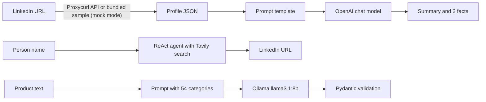

# Ice Breaker Agent

[](https://github.com/ugurtheiron/icebreaker-agent/actions/workflows/ci.yml)
[](LICENSE)


A small LangChain project that turns a LinkedIn profile into a short summary and two interesting facts, plus two related experiments: classifying products into a fixed category list with a local LLM, and extracting structured product data from web pages with Firecrawl.

It was built as a take-home exercise on top of the first part of a public LangChain course (see [Credits](#credits-and-license)).

## What it does

| Entry point | What it does | Needs |
|---|---|---|
| `ice_breaker.py` | Loads a LinkedIn profile (Proxycurl API, or the bundled synthetic sample with `--mock`), fills a prompt and asks an OpenAI chat model (`gpt-3.5-turbo`) for a short summary and two interesting facts. | `OPENAI_API_KEY`; `PROXYCURL_API_KEY` for `--url` |
| `agents/linkedin_lookup_agent.py` | A ReAct agent (`gpt-4o-mini`) with one Tavily search tool that returns the LinkedIn profile URL for a person's name. | `OPENAI_API_KEY`, `TAVILY_API_KEY`, access to LangChain Hub (pulls the `hwchase17/react` prompt) |
| `ice_breaker_v2.py` | Classifies a product into one of 54 sport categories with a local Ollama model (`llama3.1:8b`). The reply must be JSON; `parsers.py` validates it with Pydantic and rejects categories outside the list. | a running [Ollama](https://ollama.com) server with the model pulled |
| `tools/tools.py` | Extracts `product_name`, `product_category`, `barcode_code`, `seller_name` and `stock` from product pages with Firecrawl. | `FIRECRAWL_API_KEY` |
| `third_parties/jira.py` | `get_jira_issue_details()` helper: fetches a Jira issue and returns key, summary, created, assignee, priority, status and linked issues. Library function, no CLI. | a Jira URL and a Bearer token |

## How it fits together



The lookup agent and the summary chain are separate scripts: the URL printed by the agent is passed to `ice_breaker.py --url` by hand.

## Quickstart

Prerequisites: Python 3.12 (CI and local checks use 3.12) and, for the scripts that call external services, the API keys listed above.

Clone the repository, open a terminal in its root, then:

```bash
python -m venv .venv
source .venv/bin/activate        # Windows PowerShell: .venv\Scripts\Activate.ps1
pip install -r requirements-dev.txt
cp .env.example .env             # then put your own keys into .env
```

Check the setup without any API key. This prints the bundled synthetic profile and shows the command-line options:

```bash
python -m third_parties.linkedin
python ice_breaker.py --help
```

Run the scripts (each of these needs the keys or services listed in the table above and was not run against the real services):

```bash
python ice_breaker.py --mock                       # summary of the synthetic sample profile
python ice_breaker.py --url https://www.linkedin.com/in/<handle>/
python -m agents.linkedin_lookup_agent "Jane Doe"  # finds a LinkedIn URL by name
python ice_breaker_v2.py "tennis racket"           # product category with local Ollama
python -m tools.tools https://example.com/product  # Firecrawl extraction
```

## Tests and lint

```bash
ruff check .
pytest
```

The 10 tests are offline: the HTTP client and Firecrawl are replaced with fakes, so nothing calls a paid API. They cover the Pydantic output parsing and category validation (including that the prompt lists exactly the allowed categories), loading of the bundled profile from any working directory, the missing-key errors, the request that is sent to Proxycurl, the per-URL error handling of the Firecrawl extractor, and Jira field extraction. The same two commands run in [GitHub Actions](.github/workflows/ci.yml) on every push to `main` and every pull request.

## Project layout

```
ice_breaker.py                  LinkedIn profile -> summary + facts
ice_breaker_v2.py               product -> category (Ollama + Pydantic)
parsers.py                      Pydantic models and the allowed category list
env_utils.py                    reads API keys from the environment, fails with a clear message
agents/linkedin_lookup_agent.py ReAct agent that finds a LinkedIn URL
tools/tools.py                  Tavily search tool and Firecrawl extractor
third_parties/linkedin.py       Proxycurl client and the bundled sample loader
third_parties/jira.py           Jira issue helper
third_parties/linkedin_profiles/sample_profile.json   synthetic sample ("Jane Doe")
tests/                          offline pytest suite
```

Built with Python, LangChain 0.3, OpenAI, Ollama, Tavily, Firecrawl, Pydantic, pytest and ruff.

## Sample data

`third_parties/linkedin_profiles/sample_profile.json` is a synthetic sample: the person, employers and dates are invented, and the URLs use `example.com`. No real person's data is included in this repository.

## Known limitations

- **Paid and keyed services.** OpenAI, Tavily, Proxycurl and Firecrawl need your own accounts and keys, and calls to them can cost money.
- **Proxycurl is discontinued.** The service shut down in July 2025, so `ice_breaker.py --url` cannot return data any more; `--mock` is the working path. Fetching LinkedIn data is also subject to LinkedIn's terms.
- **Old library line.** Dependencies are pinned to the LangChain 0.3 releases the code was written against; newer major versions were not tried.
- **External APIs are only mocked in tests.** The Firecrawl call follows the `firecrawl-py` 1.9.0 interface, and the Proxycurl, Tavily, OpenAI and Ollama paths were not run against the live services for this repository.
- **No evaluation.** The category list is a fixed example taxonomy and the classification accuracy of the local model has not been measured.
- **Jira helper.** It sends the token as a Bearer header (fits Jira Data Center personal access tokens or OAuth 2.0 access tokens); Jira Cloud API tokens use Basic auth and are not supported.

## Contributing

Issues and pull requests are welcome: see [CONTRIBUTING.md](CONTRIBUTING.md) and the [Code of Conduct](CODE_OF_CONDUCT.md).

## Security

To report a vulnerability privately, see [SECURITY.md](SECURITY.md).

## Credits and license

The project starts from the "Ice Breaker" part of Eden Marco's [LangChain course](https://github.com/emarco177/langchain-course), which is licensed under the Apache License 2.0. Four files are derived from that code and were changed (`ice_breaker.py`, `agents/linkedin_lookup_agent.py`, `third_parties/linkedin.py` and the `get_profile_url_tavily` function in `tools/tools.py`); each states its changes in its header. The product classification, output parsers, Firecrawl extractor, Jira helper, tests and CI are original work.

Released under the [MIT License](LICENSE). The parts taken from the course remain under the Apache License 2.0 ([LICENSES/Apache-2.0.txt](LICENSES/Apache-2.0.txt)); see [NOTICE](NOTICE).
